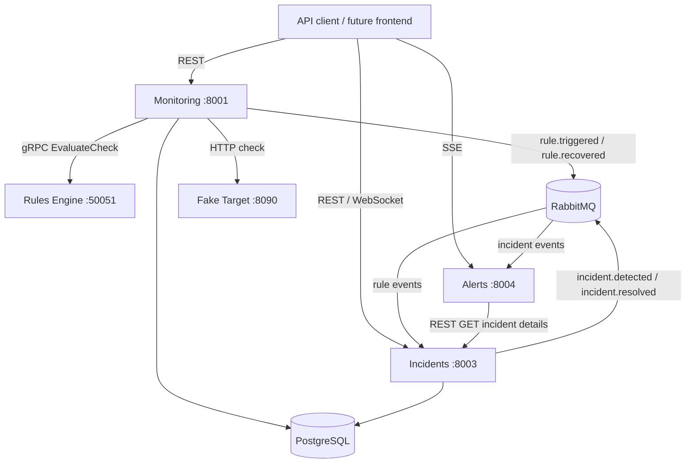

# SignalWatch — Monitoring & Incident Management PoC

A **one-week, open-source learning project** built with four Python/FastAPI microservices. Monitor HTTP endpoints, detect repeated failures, create incidents, and notify users live.

> **This is a scaffold, not a finished backend.** Domain functions intentionally contain `...`. The complete test suite, contracts, infrastructure and a controllable fake target are provided. You implement the business logic. Tests are **expected to fail** until that logic is implemented.

## Scope: deliberately small

- Four services: **Monitoring**, **Rules Engine**, **Incidents**, **Alerts**.
- One programmable **fake target**, used **only as test infrastructure**.
- REST, synchronous gRPC request/response, asynchronous RabbitMQ events, SSE and WebSocket.
- Postgres: persist monitors and incidents (each service owns its tables). Rules state and live subscribers are in-memory **for this single-instance PoC**.
- No login, billing, Kubernetes, API gateway, frontend, distributed scheduler or production-grade observability. **Frontend comes after backend completion.**

## Architecture



**Precisely where each mechanism fits:**

| Mechanism | Contract | Purpose |
|---|---|---|
| REST | `POST /monitors`, `GET /incidents`, etc. | Configuration and querying; also **Alerts → Incidents** sync lookup |
| gRPC (sync request/reply) | `RulesEngine.EvaluateCheck` | Monitoring awaits a rule evaluation |
| RabbitMQ (async messaging) | `rule.*`, `incident.*` | Producer does **not** await consumers |
| SSE | `GET /alerts/stream` | Server → connected client, incident notifications |
| WebSocket | `/ws/incidents/{id}` | Client ↔ server, collaborative incident comments |

A *synchronous interaction* means the caller awaits the result; internally both HTTP and gRPC can use async Python I/O.

## Start the infrastructure

Requirements: **Docker + Docker Compose**; for local tests **Python 3.12+** and `curl` (and optionally `jq`, not required).

```bash
cp .env.example .env
docker compose up --build -d
docker compose ps
bash scripts/smoke.sh
```

Local ports (bound to localhost): `8001` Monitoring, `8002` Rules health HTTP, `8003` Incidents, `8004` Alerts, `8090` fake target, `50051` gRPC, `15672` RabbitMQ admin (`poc` / `local_development_only`, development only).

`/health` endpoints and the fake target work on day one. Domain API operations will fail until implemented; **that is intentional**. The fake target exposes `POST /__test__/mode` with `{"status_code":503,"delay_ms":0}` and `POST /__test__/reset`.

## Implement only these core features

1. **Monitoring**: CRUD for HTTP monitors; schedule sequential checks *per monitor*; manual `/check`; async `httpx` checks (2xx healthy, other status codes and timeouts unhealthy); store monitors in Postgres; call Rules via gRPC; publish only state-change events to RabbitMQ.
2. **Rules Engine**: keep `{failures, alerting}` per monitor in memory; evaluate failures; transition to `TRIGGERED` once at threshold and to `RECOVERED` once on the next success. No separate rules CRUD: `failure_threshold` is part of a monitor.
3. **Incidents**: consume rule events; create at most one active incident per monitor; on recovery resolve it; persist in Postgres; ack through REST; publish incident events; WebSocket relay of comments to connections subscribed to the same incident (comments need not be persisted).
4. **Alerts**: consume incident events; use **synchronous REST GET** to fetch the saved incident from Incidents; forward it to connected SSE subscribers.

> **Idempotency rule:** Duplicate broker deliveries must not create duplicate active incidents. At most one active incident (`OPEN`/`ACKNOWLEDGED`) per monitor. The check response must return `NONE` except when the state actually changes.

## Endpoint contracts

See **[docs/API.md](docs/API.md)** for the complete route list, request/response examples and codes; **[contracts/rules.proto](contracts/rules.proto)** and **[contracts/events.md](contracts/events.md)** for RPC and broker events; **[docs/TASKS.md](docs/TASKS.md)** for the seven-day implementation order.

## Tests — written for you

```bash
python -m venv .venv
source .venv/bin/activate
pip install -r requirements-dev.txt
bash scripts/generate_proto.sh

# Offline tests (Rule Engine tests RED until you implement engine.py):
python -m pytest tests/unit -q

# After docker compose up and backend implementation:
bash scripts/smoke.sh
bash scripts/flow.sh
bash scripts/test.sh  # all unit + E2E, includes gRPC, SSE and WebSocket
```

Tests deliberately assert **behavior** rather than specific Postgres tables or RabbitMQ client code. See **[docs/TESTING.md](docs/TESTING.md)** for required flow, expected responses and test isolation.

## Demo flow

1. Register monitor `http://fake-target:8090/health` with threshold `3` and interval `3600` (manual tests won't race with the scheduler).
2. `POST http://localhost:8090/__test__/mode` to set `503`.
3. Call `POST /monitors/{id}/check` three times; expect `NONE, NONE, TRIGGERED`.
4. An `OPEN` incident appears through RabbitMQ; Alerts sends `incident_detected` over SSE.
5. Two users exchange a WebSocket comment; one acknowledges the incident through REST.
6. Reset fake target to `200`; run one check; expect `RECOVERED`, a resolved incident and `incident_resolved` via SSE.

## Limitations and safety

This is **not production-ready**. Arbitrary URLs can cause **SSRF**; run only with trusted targets on an isolated development network. There is no auth, rate limiting, secret management, persistent Rules state, replayable SSE history, multi-instance pub/sub for live sockets, durable outbox, or distributed scheduling. Before exposing publicly, add URL/DNS/IP allowlisting, auth, per-target concurrency/rate limits, request timeouts, and a durable publication strategy. `fake_target` control endpoints must never be exposed to the internet.

## Open source

Licensed under [MIT](LICENSE). Contributions are welcome once the PoC works. The intended first milestone is **correct event flow**, not performance or feature count.
